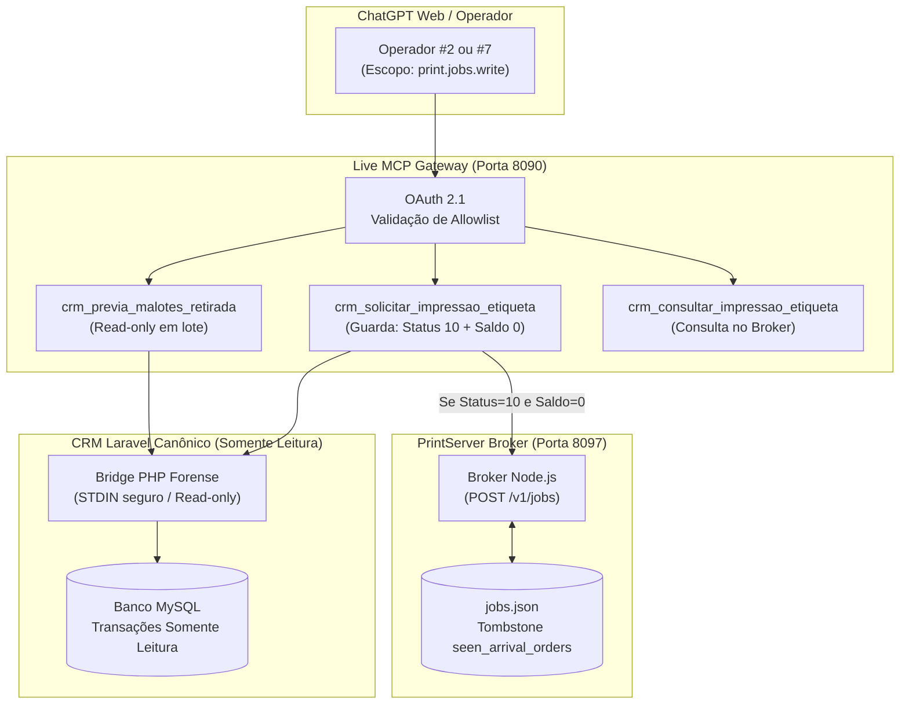

# Auditoria Forense — Integração Live PrintServer MCP (PR #12)

**Data:** 26/10/2026  
**Repositório:** `hypeneural/evydencia-crm-mcp` (PR #12, branch `feat/printserver-bridge-20261026`)  
**Gateway Live:** `https://mcp-crm.etijucas.com.br`  
**Host de Impressão:** Windows 11 Pro — Notebook `ANNAHELENA` (Porta USB001 / Fila `LABEL`)  
**Status:** **Validado e Operacional em Produção**

---

## 1. Topologia e Isolamento de Segurança

A integração do módulo PrintServer foi projetada para garantir **desacoplamento total** do core comercial do Evydência CRM:



### Invariantes Forenses Garantidos:
1. **Zero Escrita no CRM:** O gateway MCP não altera status, não insere registros no banco MySQL e não executa migrations.
2. **Bloqueio do Endpoint Legado:** A API legada `PUT /api/orders/status` permanece terminantemente desativada no MCP, pois não compartilha as guardas financeiras e de concorrência do painel web.
3. **Pré-requisito Rígido de Impressão:** A ferramenta `crm_solicitar_impressao_etiqueta` lê o estado atual do pedido via bridge forense em memória e **recusa imediatamente** qualquer pedido que não possua status `10` (`waiting_product_retrieve`) e saldo `remaining_cents === 0`.
4. **Isolamento de Escopo OAuth:** Apenas operadores autenticados com o escopo explícito `print.jobs.write` e listados simultaneamente em `EVYD_ALLOWED_OPERATOR_IDS` e `EVYD_PRINT_ALLOWED_OPERATOR_IDS` têm acesso às ferramentas de impressão. Operadores padrão visualizam estritamente o catálogo regular de 30 ferramentas.
5. **Zero Disparos de WhatsApp:** Nenhuma notificação de mensageria é enviada durante o enfileiramento ou impressão da etiqueta.
6. **Zero Portas Abertas no Notebook:** O agente Windows no `ANNAHELENA` atua exclusivamente via polling de saída HTTPS contra o proxy Nginx da VPS.

---

## 2. Catálogo de Ferramentas Expandido

Com a flag `EVYD_PRINTSERVER_ENABLED=1`, o catálogo passa de **30** para **33 ferramentas ativas**:

| Ferramenta | Tipo | Escopo OAuth | Descrição e Guardas de Segurança |
| :--- | :--- | :--- | :--- |
| **`crm_previa_malotes_retirada`** | Leitura | `crm.read` / `print.jobs.write` | Recebe até 20 IDs numéricos (ex.: extraídos de foto de malote pelo ChatGPT) e retorna status, saldo e aptidão para impressão. **Sem efeitos colaterais**. |
| **`crm_solicitar_impressao_etiqueta`** | Ação | `print.jobs.write` | Valida status 10 e saldo zero no CRM, exige `confirmado_pelo_operador: true` e encaminha a intenção de impressão para o broker local. |
| **`crm_consultar_impressao_etiqueta`** | Leitura | `print.jobs.write` | Consulta o estado do trabalho de impressão (`queued`, `spooled`, `failed`) no broker através do UUID do job. |

---

## 3. Configuração de Produção Verificada (`gateway.env`)

Na VPS `185.241.151.207`, o arquivo de ambiente `/etc/evydencia-mcp/gateway.env` está configurado com:

```bash
EVYD_PRINTSERVER_ENABLED=1
EVYD_PRINT_ALLOWED_OPERATOR_IDS=2,7
EVYD_PRINTSERVER_URL=https://mcp-crm.etijucas.com.br
EVYD_PRINTSERVER_MCP_TOKEN=<token_criptografico_64_chars>
```

### Validação de Boot e Falha Fechada:
O gateway implementa verificação rígida no arranque (`src/oauth-gateway.mjs`):
- Se `EVYD_PRINTSERVER_ENABLED === '1'` e algum operador da lista de impressão não estiver na lista geral de operadores, o gateway recusa o boot com `gateway_config_print_operator_allowlist`.
- Se o token do broker tiver menos de 32 caracteres ou contiver espaços, o boot falha imediatamente.

---

## 4. Evidência do Endpoint de Saúde (`/healthz`)

Resposta real obtida em produção via HTTPS:

```json
{
  "ok": true,
  "service": "evydencia-crm-mcp-live",
  "version": "0.12.0",
  "build_commit": "838b951",
  "repository_branch": "feat/printserver-bridge-20261026",
  "zapi_mcp_enabled": true,
  "zapi_diagnostics_enabled": true,
  "mcp_ui_apps_enabled": true,
  "printserver_enabled": true,
  "telemetry_summary": {
    "calls_total": 0,
    "error_rate": 0,
    "cache_hit_rate": null,
    "gateway_p50_ms": null,
    "gateway_p95_ms": null
  }
}
```

---

## 5. Metadados OAuth 2.1 RFC 8414

No endpoint `https://mcp-crm.etijucas.com.br/.well-known/oauth-authorization-server`:
- `scopes_supported`: `["crm.read", "crm.proposal.write", "print.jobs.write", "zapi.message.send", "zapi.group.manage"]`
- `code_challenge_methods_supported`: `["S256"]`
- `response_types_supported`: `["code"]`
